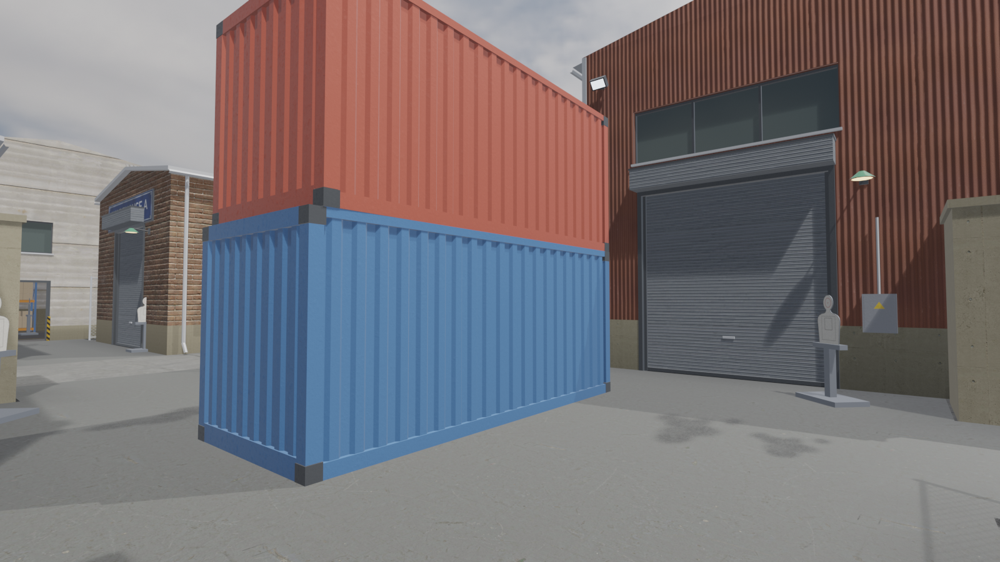
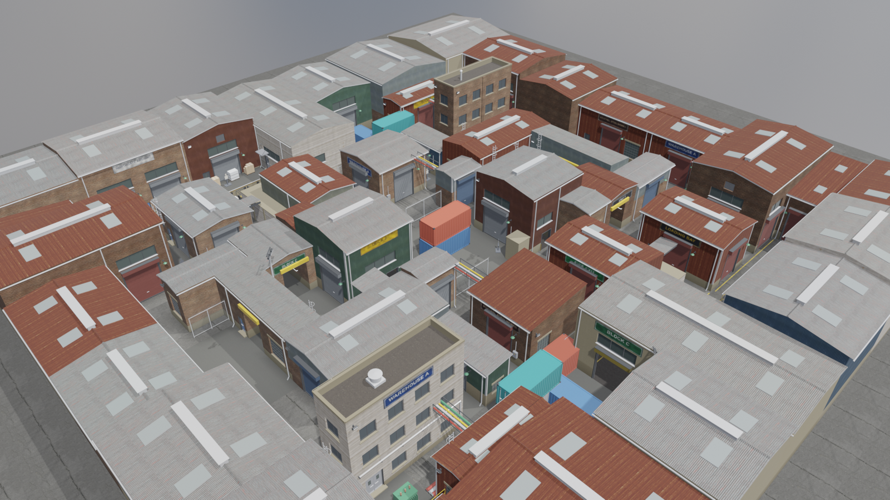
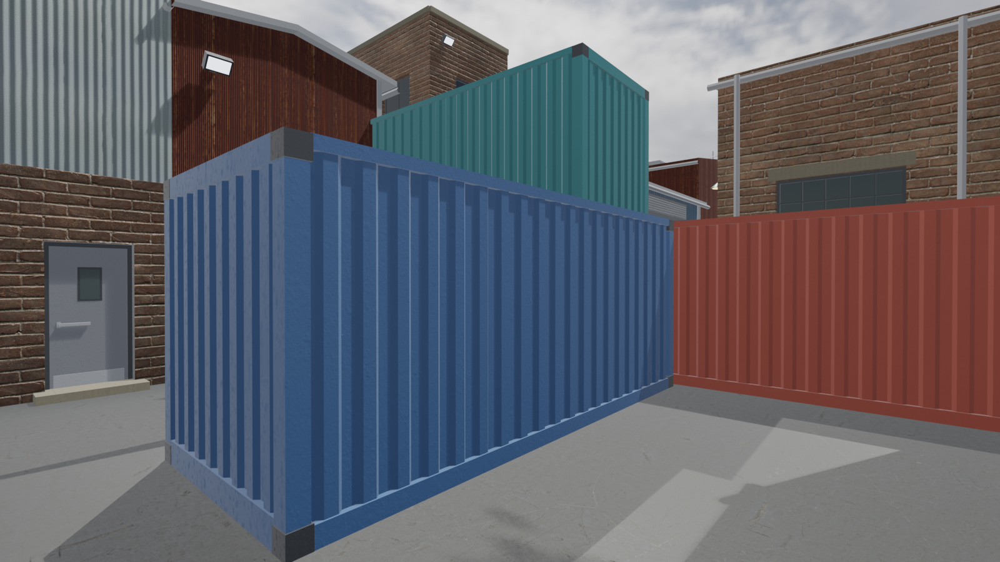
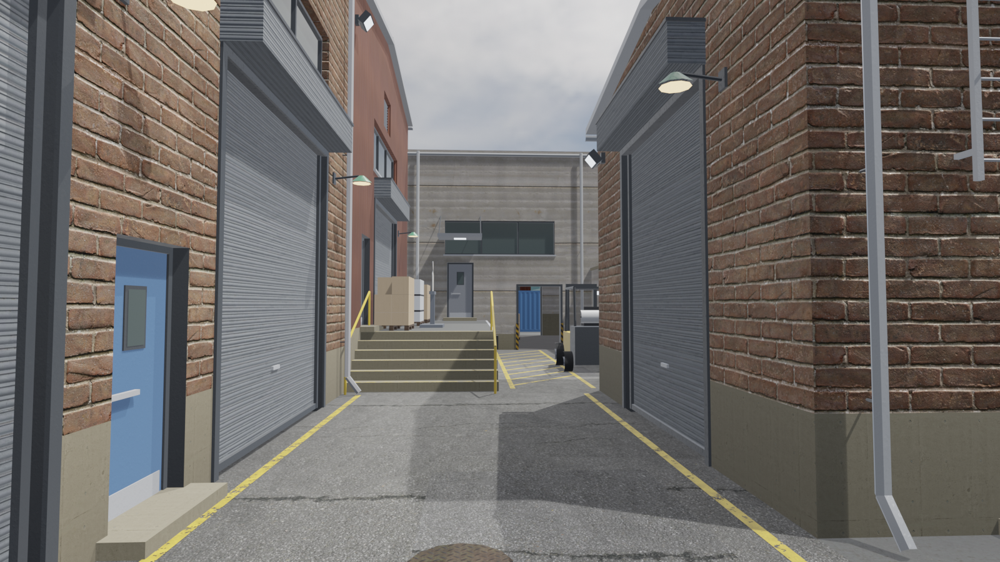
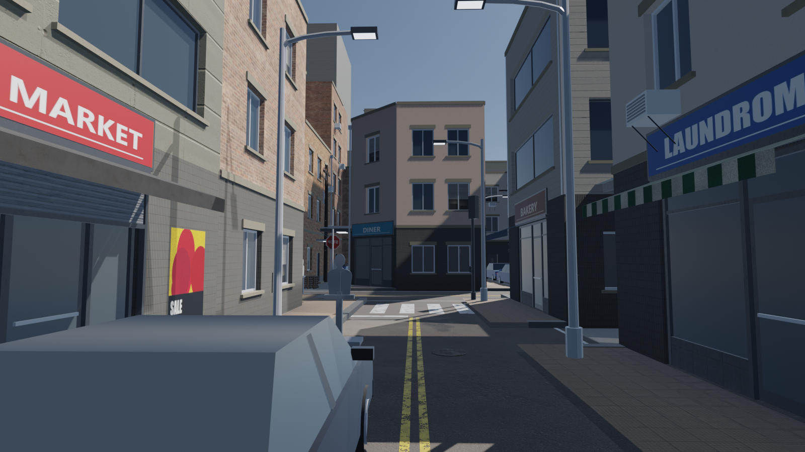
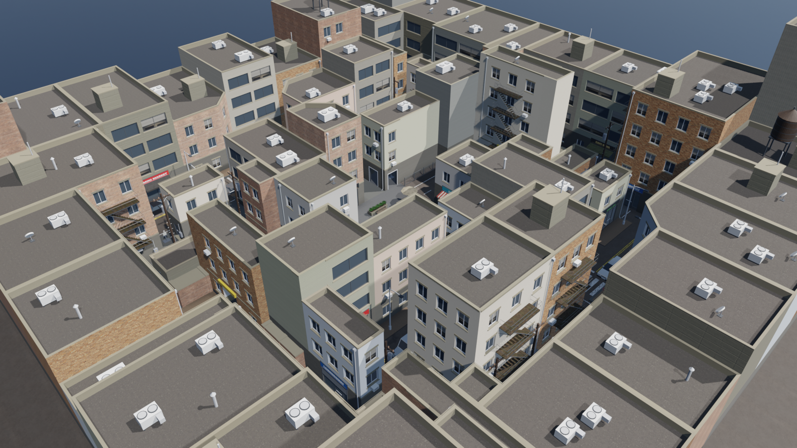
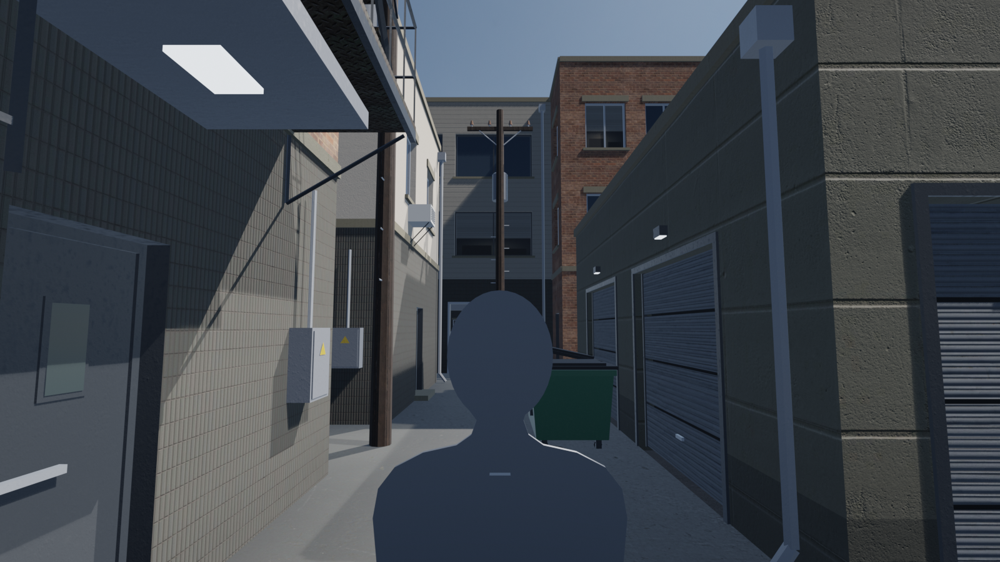
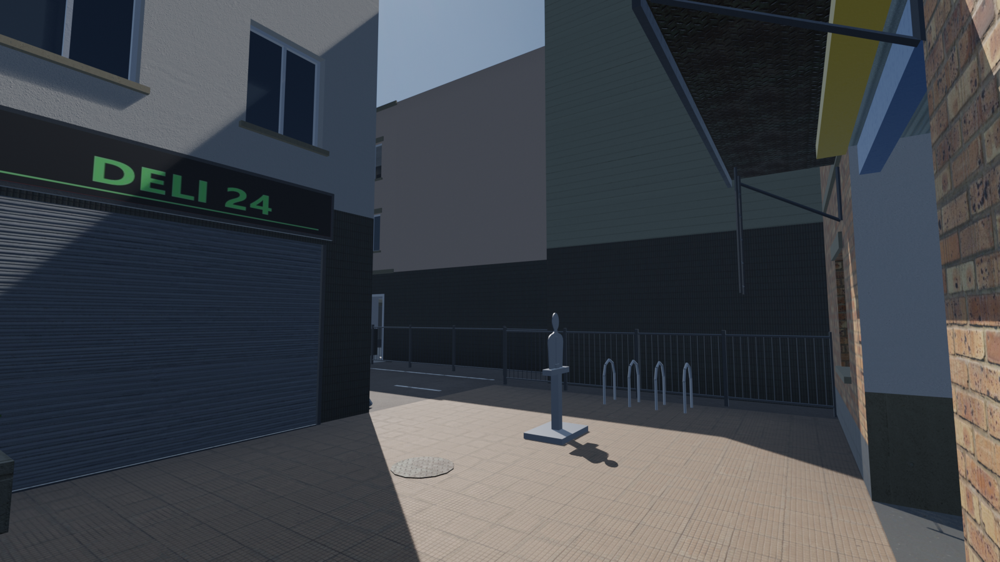

# Crossfire

A first-person shooter prototype that runs in a desktop browser. Built with **TypeScript**, **Babylon.js 9** and **Vite**; every 3D model is generated by **Blender** Python scripts.

Multiplayer uses **protocol v6** with validated incoming-shot directions for short death/fade animations and red damage-edge/turn-arrow feedback, alongside server-controlled weapons, player health, world-blocked hits, 1.5x headshots, eliminations, scores and approved respawns. FFA and Teams use authoritative relationships with friendly fire disabled. Visible opponents have red outlines/names; teammates have blue outlines, with blue names visible through walls. Remote players load an actual Blender humanoid with idle, running, jump and slide clips; geometry/materials are shared and each rig animates independently. See [combat visuals and preview](docs/COMBAT_VISUALS.md), the [character pipeline](docs/CHARACTER_PIPELINE.md) and [combat/local PowerShell runbook](docs/MULTIPLAYER_COMBAT.md). Publish matching protocol-v6 frontend/backend builds only when authorized.

The home displays the same animated character skin, framed from the head to the upper thighs with a soft fade, over an optimized eye-level image of the actual Town well plaza. The home retains its gently animated blurred backdrop, original crossed-rifles wordmark, Play/Settings navigation and blue bottom-centered Play button. Home Settings fills the screen with the existing draft controls and category sidebar; pause Settings keeps its compact presentation. It does not load playable maps, environment textures or weapon models. Play opens a dark-gray LOADING screen with a small spinner, connects to the Cloudflare Worker and loads the server-selected map before pre-spawn. Back in the top left cancels the join/loading operation and returns home, including during a round transition; Play can be tried again afterward. The spinner respects reduced-motion preferences. Four horizontal cards select SMG, Assault Rifle, Sniper Rifle or Shotgun for the next life; the approved weapon stays locked during play. Escape > Leave Match disconnects cleanly. See [PowerShell commands](server/README.md) and the current [PROGRESS.md](PROGRESS.md).

On the first visit, choose a guest username; returning visits restore it automatically. Change it under **Settings > Gameplay > Username**, then **Apply** (Back discards edits). The name is used on the next join/reconnect. A separate browser-local `crossfire.guest.v1` profile stores the name and random guest ID; it never authenticates a player and is never sent as a server session ID. The Worker validates display names and assigns its own session IDs. Clearing browser data creates a new guest; blocked/full storage permits temporary play. There are no accounts, passwords or login database.

The canonical public room rotates all three maps using persisted, server-seeded shuffled bags and ten-minute deadlines, including empty-room catch-up. Clients agree on the map, collision revision, round ID and remaining time, and load transitions without a page refresh. Server-authoritative player combat, FFA/Teams assignment, health and scores are implemented and tested locally; a dedicated match-results phase remains unfinished. `?practice` retains local map/weapon development.

Three free-for-all practice maps, each with 16 spawn points spread over the map and 24 steel silhouette targets:

- **European Town**: a compact, maze-like old town of stone and stucco houses with narrow cobbled lanes, arches and small courtyards.
- **Industrial Complex**: packed warehouses and workshops, loading docks, service alleys, a container yard, pipe bridges and walk-through halls.
- **Modern City**: a tight downtown block of brick apartments, shops and offices with narrow streets, back alleys, courtyards, a plaza and walk-through storefronts.

Four weapons: a compact **SMG**, an **assault rifle** with a holographic sight, a **pump shotgun** and a **bolt-action sniper rifle** with a
magnified scope. Reloads smoothly lower and return the weapon without visible hands or arms; pump and bolt cycles remain. Reserve ammunition is infinite; magazines are not. Headshots deal 1.5x body damage, so a sniper
headshot kills outright. Hold **Tab** for the real connected-player leaderboard with server-reported weapon silhouettes (empty in explicit offline practice). Unavailable weapon selections show a neutral placeholder. The small home player count falls back to zero when unavailable while retaining that distinction internally.


| | |
|---|---|
|  |  |
|  |  |
|  |  |
|  |  |
|  |  |
|  |  |

*Blender EEVEE previews written by the asset pipeline (`docs/previews/`, one folder per new map). In-game screenshots from the automated browser tests land in `test-results/` (git-ignored).*

## Quick start

Requirements: Node.js 20.19+ (tested with 24), a browser with WebGL 2 (current Chrome, Edge, Firefox or Safari).

```bash
npm install
npm run dev        # http://localhost:5173
```

Production build and preview:

```bash
npm run build      # type-check + bundle into dist/
npm run preview    # http://localhost:4173
```

The generated assets are committed, so you only need Blender if you want to change or regenerate models (see [Asset pipeline](#asset-pipeline)).

## Controls

| Key | Action |
|---|---|
| W A S D | Move |
| Mouse | Look |
| Shift | Slide (about 1 s; release and press again after the 1 s cooldown) |
| Space | Jump |
| Left click | Fire |
| Right click | Aim down sights |
| R | Reload |
| 1 / 2 / 3 | Weapon slots in practice automation only; public loadout is locked |
| Q | Previous weapon in practice automation only |
| Mouse wheel | Weapon cycling in practice automation only |
| Tab (hold) | Leaderboard (hides on release/blur; the game keeps running) |
| Esc | Pause / release the mouse |
| F3 | Toggle the FPS counter |
| F2 | Toggle the collision debug view |

Ctrl and C have no crouch binding. While you are in a match, the game asks before a browser shortcut closes the page.

## Features

- **European Town map**: 66 × 66 m playable area, 80 procedurally modelled buildings in 16 street blocks (plus a ring of backdrop houses), lanes 3–5 m wide, four courtyards/yards, a central well plaza, two raised terraces with stone stairs, six covered passages (arched bridges, gatehouses, walk-through halls), eight flying arches over lanes, and 161 props.
- **Industrial Complex map**: 68 × 68 m, 52 buildings (warehouses, workshops, offices, sheds) with corrugated, brick and concrete walls, roller doors, factory windows, signs, floodlights and roof plant (HVAC units, extractor fans, vents, skylights); four accessible interiors (two walk-through halls and two workshops), service lanes and yards, two raised loading docks and two gantry platforms with concrete stairs and railings, fences and concrete walls, four pipe bridges and four covered walkways over the lanes, road paint and oil stains. Cooler daylight under a pure-sky HDRI.
- **Modern City map**: 68 × 68 m, 62 buildings (apartments, commercial blocks, corner shops, storefronts, garages) in brick, stucco, concrete and cladding, with fire escapes, window AC units, fascia and blade signs, awnings and rooftop water tanks; raised sidewalks with curbs and crossings, back alleys with dumpsters and overhead wires, four walk-through interiors (two diners, two markets), streetlights, utility poles, traffic lights, street signs, benches, planters, café tables and parked cars. Bright daytime lighting.
- **Leaderboard (hold Tab)**: connected server players, kills/deaths sorted by kills descending/deaths ascending, local-session highlight, and a compact server-owned mode/time header. Includes pre-spawn clients and closes on release, blur or menus. Teams assignments and scores come from the Worker. Pure tactical-map derivation/export utilities remain available for level development.
- **All eight requested building types**: two-story stone townhouse, three-story plaster townhouse, shop, chamfered corner building, narrow building with a passage, building with an archway, building with a balcony, and building with an accessible ground-floor room. Each has two catalogue variants in `public/assets/models/shared/buildings/`.
- **Public modes**: server-selected Free For All or Teams, without safe zones. Teams disables friendly fire. Each map has 16 spawn points spread over the whole map (clear of props, targets, doors and stairs, facing their longest open line); you spawn at a random one, never the same one twice in a row.
- **Movement**: shared server/prediction simulation at 120 Hz with acceleration/friction, a one-second Shift slide (captured momentum, limited steering, deceleration and a one-second cooldown), smooth lowered camera/body with safe standing clearance, jump (coyote time and input buffer, no double jump), and step-up for stairs/curbs. Sprint and separate crouch controls are removed. Protocol v6 requires matching client/backend builds.
- **Weapons** (Blender models, conventional firearms, original synthesised sounds):
  - *SMG*: original compact model, 960 RPM, 32-round magazine, 11 damage per bullet, original synthesized shot, infinite reserve and weapon-only reload motion.
  - *Assault rifle*: automatic, 700 RPM, 30-round magazine, 25 damage (37.5 to the head), holographic sight with a crisp red ring-and-dot reticle; tactical reload 2.1 s, from empty 2.6 s (with the bolt release).
  - *Pump shotgun*: 6 shells, 9 pellets of 12 damage in a 3.4° cone, falling off beyond 7 m, heavy recoil; pumped after every shot; reloaded one shell at a time (pull the trigger to stop loading).
  - *Sniper rifle*: bolt action, 5-round magazine, 75 damage (112.5 to the head: one-shot headshots), 4.5x scope overlay with mil-dots and breathing sway, wild from the hip; works the bolt after every shot.
  - Infinite reserve, limited magazines; switching holsters one weapon and draws the next (a reload is abandoned).
  - First-person view: original weapon models without hands or arms; reloads use a short smooth lowering/return motion while preserving timing and sounds; warm muzzle flashes, ejected brass cases and shotgun hulls that bounce, bullet holes, sparks and dust.
- **Practice targets**: 24 steel silhouettes with a head and a body zone (headshots deal 1.5x body damage); they wobble when hit, tip over at 0 health and reset after 3 s.
- **Rendering**: CC0 PBR textures (Poly Haven), HDRI image-based lighting plus a 4K sky, a sun matched to the sky's sun, shadows (render-once whole-map shadow map on Low/Medium, cascaded on High), ACES tone mapping, fog, bloom, MSAA/FXAA, optional SSAO, and baked vertex-colour grime and contact darkening.
- **UI**: minimal main menu (CROSSFIRE, Play, Settings; no map controls or status panels), loading screen, click-to-play card, HUD (crosshair with live spread, health, ammo with infinite reserve, weapon slots, map name, sniper scope overlay, FPS, targets down / headshots / accuracy), pause menu and a tabbed settings screen (Gameplay: sensitivity, invert Y, FOV; Sound: master volume; Graphics: quality, shadows, resolution scale, FPS counter) with Apply / Back: edits stay a draft until Apply, which applies them live and saves them to `localStorage`; Back discards them.
- **Map system**: a registry of `MapDefinition`s and a generic `MapManager` that loads and unloads any map that ships a layout, GLBs and collision data. Switching maps disposes the old map's meshes, materials and textures (checked: object counts return to the same values after switching away and back) and keeps your settings.

## Project structure

```
src/
  core/        input, asset URLs
  config/      tuning constants, persisted settings
  physics/     CollisionWorld (oriented boxes, cylinder sweep, ground probe, raycast); no Babylon
  player/      PlayerController (kinematic), PlayerCamera (view smoothing)
  weapons/     Weapon (state machine), WeaponView (first-person model), Effects
  game/        Game (state machine + loop), SafeZones, Damage, Targets, Teammates (friendly-marker registry)
  maps/        types, registry, MapManager, tactical (overhead map data), one folder per map (layout.json + definition)
  rendering/   RenderContext, Environment, MaterialLibrary, StaticBatcher, PostFX, quality presets
  ui/          DOM menus, weapon previews, HUD and server leaderboard
  audio/       Web Audio manager
public/assets/ models (GLB), textures, env (HDRI/sky), audio, materials.json, asset-manifest.json
blender/
  scripts/     generate_all.py + lib/ (meshkit, building, roof, kit, props, terrain, weapon, ...)
  source/      generated, editable .blend files
tools/         layout designer, texture/audio generators, Blender runner, test and dev tools
tests/         Vitest unit tests
references/    reference images (layout + style); not part of the build
docs/          architecture, pipeline, level design, deployment, plans and previews
```

## Asset pipeline

Everything visual is reproducible from scripts:

```bash
python -I tools/fetch_textures.py          # download CC0 textures + sky from Poly Haven (cached in .cache/)
python -I tools/layout_design.py --write   # regenerate the European Town layout (and docs/european-town-plan.png)
python -I tools/layout_industrial.py --write   # Industrial Complex layout (docs/industrial-complex-plan.png)
python -I tools/layout_city.py --write     # Modern City layout (docs/modern-city-plan.png)
npm run assets                             # procedural textures + audio, then all Blender stages
npm run assets -- --only town --previews   # one map stage (town, industrial, city), plus preview renders
npm run assets:verify                      # check every generated file and material reference
python -I tools/make_thumbnails.py         # menu thumbnails from the aerial previews
node tools/export-tactical.mjs             # tactical maps as JSON + SVG (docs/tactical/)
```

`npm run assets` finds Blender automatically (or set `BLENDER_PATH`). It was developed with Blender 5.2.3; each new map stage takes about a minute and a half with its previews. Details: [docs/ASSET_PIPELINE.md](docs/ASSET_PIPELINE.md). To edit the map layout, see [docs/LEVEL_DESIGN.md](docs/LEVEL_DESIGN.md).

## Testing

```bash
npm test                         # unit tests: movement/collision, every map's reachability and FFA spawns, damage + headshots, the three weapons and switching, tactical map, settings + draft (Apply/Back), assets, z-fighting geometry
npm run typecheck
node tools/home-test.mjs         # minimal home, full title at desktop/narrow sizes, Settings/Back, Play and network observation
node tools/browser-test.mjs      # headless Chrome/Edge against `npm run dev`: walks, all three weapons, headshots, reload animation, held leaderboard
node tools/browser-test.mjs --shots                                     # also saves screenshots to test-results/
node tools/maps-test.mjs         # every map through the Play path: spawn, walk, leaderboard, headshot; switching leaks
node tools/perf-test.mjs [--map modern-city]                            # uncapped FPS per graphics preset
node tools/serve-dist.mjs        # serve dist/ under /crossfire/ like GitHub Pages
```

See [docs/TESTING.md](docs/TESTING.md) for what each check covers and the measured results.

## Deploying to GitHub Pages

1. Create an empty repository on GitHub (any name).
2. In this folder:
   ```bash
   git add -A
   git commit -m "Crossfire milestone 1"
   git branch -M main
   git remote add origin https://github.com/<you>/<repo>.git
   git push -u origin main
   ```
3. On GitHub, open **Settings → Pages** and set **Source** to **GitHub Actions**.
4. The workflow in `.github/workflows/deploy.yml` tests, builds and publishes on every push to `main`. The site appears at `https://<you>.github.io/<repo>/`.

The build uses a relative base path (`./`), so it works under any repository name without configuration. To force an absolute base, set `BASE_PATH` (for example `BASE_PATH=/crossfire/ npm run build`, or edit the workflow). More in [docs/DEPLOYMENT.md](docs/DEPLOYMENT.md).

## Credits and licences

- Textures and HDRI: [Poly Haven](https://polyhaven.com), CC0. See `public/assets/textures/CREDITS.md`.
- Procedural textures (signs, foliage, awnings, target, effects) and all sound effects are generated by this project's scripts.
- 3D models are generated by the Blender scripts in `blender/scripts/`.
- Reference images in `references/` were collected for internal design reference only and are not part of the build. Check their rights before publishing the repository publicly.
