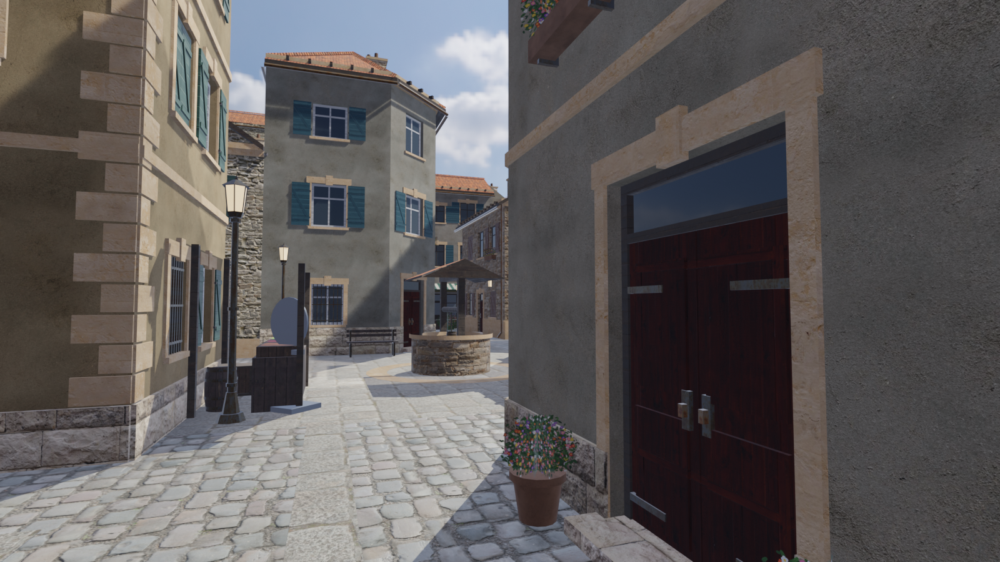
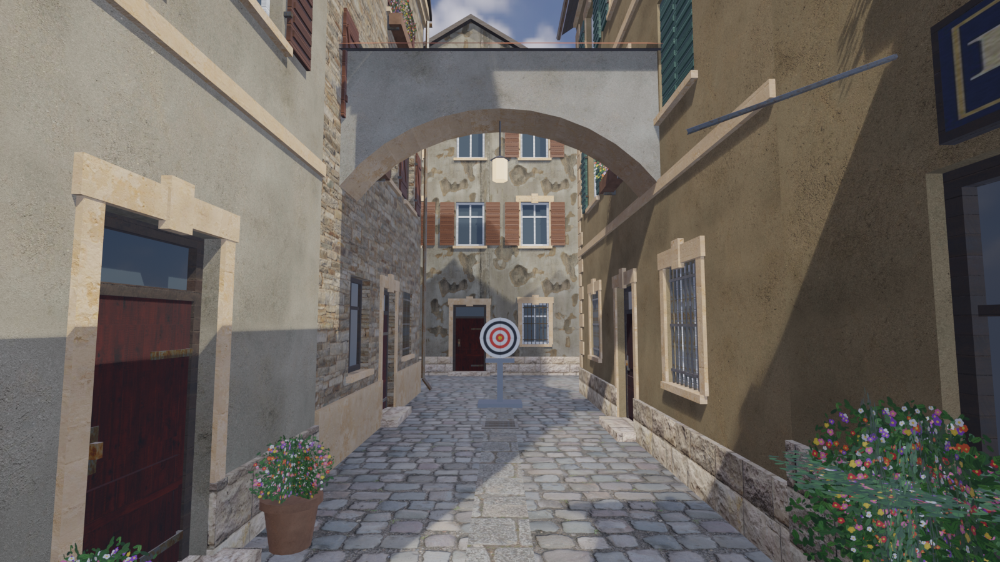
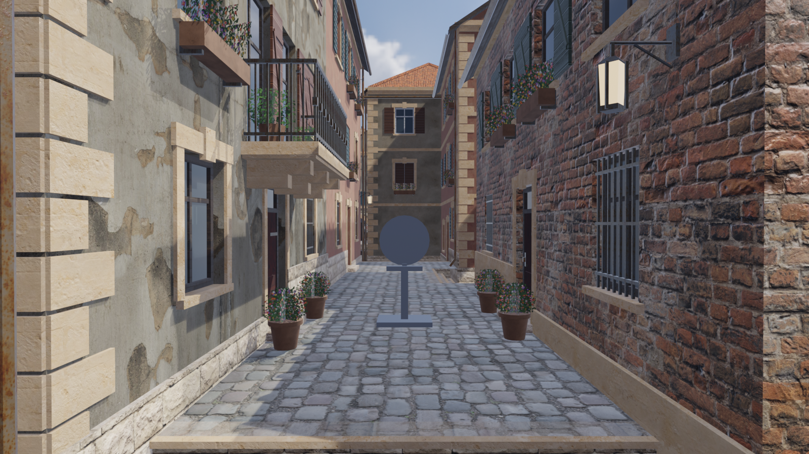
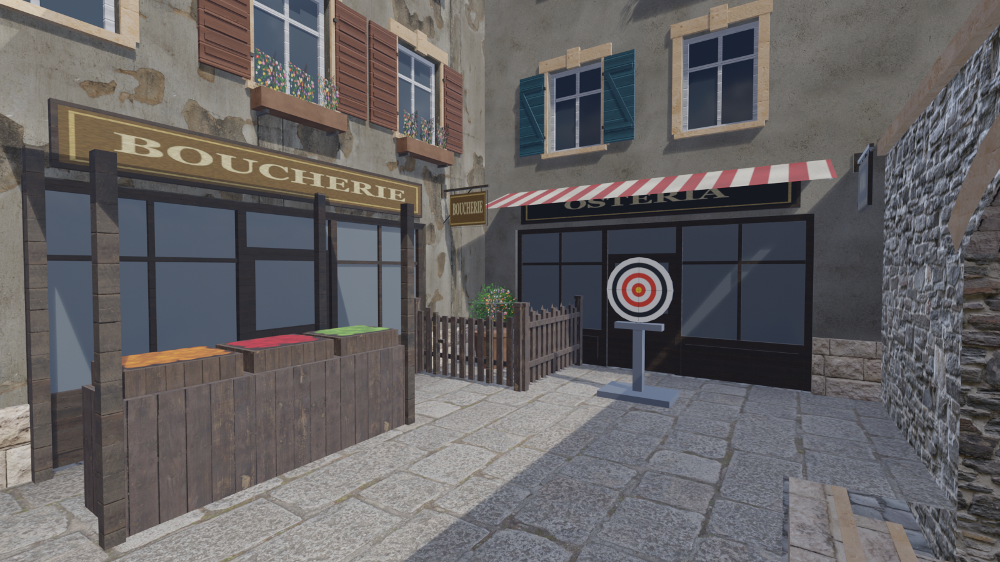
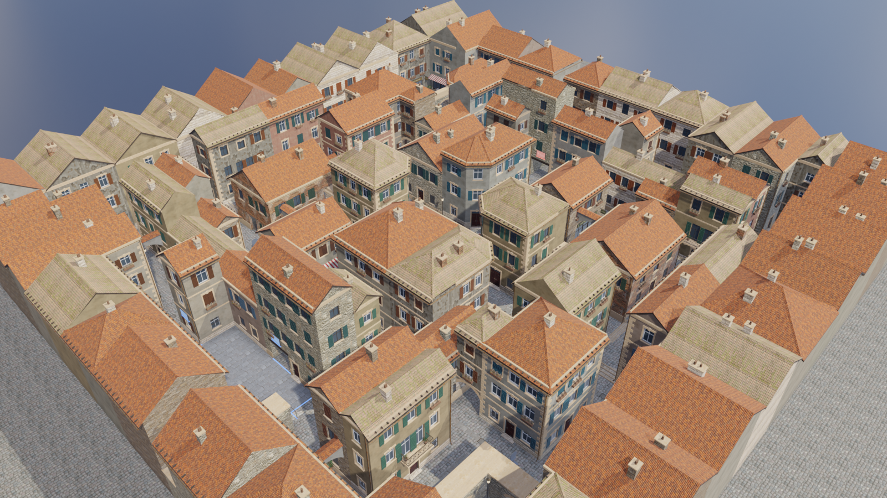

# Crossfire

A first-person shooter prototype that runs in a desktop browser. Built with **TypeScript**, **Babylon.js 9** and **Vite**; every 3D model is generated by **Blender** Python scripts.

Milestone 1 is a single-player practice map, **European Town**: a compact, maze-like old town of stone and stucco houses with narrow cobbled lanes, arches, small courtyards and two safe zones. You can walk the lanes, enter both safe zones, aim, shoot and knock down practice targets.



| | |
|---|---|
|  |  |
|  |  |

*Blender EEVEE previews written by the asset pipeline (`docs/previews/`). In-game screenshots from the automated browser tests land in `test-results/` (git-ignored).*

## Quick start

Requirements: Node.js 20.19+ (tested with 24), a browser with WebGL 2 (current Chrome, Edge, Firefox or Safari).

```bash
npm install
npm run dev        # http://localhost:5173
```

Production build and preview:

```bash
npm run build      # type-check + bundle into dist/
npm run preview    # http://localhost:4173
```

The generated assets are committed, so you only need Blender if you want to change or regenerate models (see [Asset pipeline](#asset-pipeline)).

## Controls

| Key | Action |
|---|---|
| W A S D | Move |
| Mouse | Look |
| Shift | Sprint |
| Space | Jump |
| Ctrl or C | Crouch |
| Left click | Fire |
| Right click | Aim down sights |
| R | Reload |
| Esc | Pause / release the mouse |
| F3 | Toggle the FPS counter |
| F2 | Toggle the collision debug view |

Ctrl+W closes the tab in most browsers. Use C to crouch if that is a habit; while you are in a match, the game asks before it lets the page close.

## Features (milestone 1)

- **European Town map**: 66 × 66 m playable area, 80 procedurally modelled buildings in 16 street blocks (plus a ring of backdrop houses), lanes 3–5 m wide, four courtyards/yards, a central well plaza, two raised terraces with stone stairs, six covered passages (arched bridges, gatehouses, walk-through halls), eight flying arches over lanes, and 169 props.
- **All eight requested building types**: two-story stone townhouse, three-story plaster townhouse, shop, chamfered corner building, narrow building with a passage, building with an archway, building with a balcony, and building with an accessible ground-floor room. Each has two catalogue variants in `public/assets/models/shared/buildings/`.
- **Safe zones**: blue and red spawn yards at opposite edges, marked by translucent coloured veils across every entrance, floating "BLUE ZONE" / "RED ZONE" labels that always face you, glowing ground inlays and coloured light. Damage is blocked when either the attacker *or* the target overlaps a zone, so you can't fire across the boundary. Entering a zone resupplies ammo.
- **Movement**: fixed-timestep (120 Hz) kinematic controller with acceleration, friction, sprint, crouch (with head-room check), jump (coyote time and input buffer, no double jump), step-up for stairs and curbs, and smoothed camera on steps and landing.
- **Weapon**: VK-7 pulse carbine (Blender model): hitscan, 600 RPM, 30-round magazine, reserve and reload, hip/ADS spread, recoil, aim-down-sights through a holo sight, muzzle flash, tracers, sparks and scorch decals.
- **Practice targets**: 24 targets that wobble when hit, tip over when knocked down (bullseye hits deal 2.5× damage) and reset after 3 s.
- **Rendering**: CC0 PBR textures (Poly Haven), HDRI image-based lighting plus a 4K sky, a sun matched to the sky's sun, shadows (render-once whole-map shadow map on Low/Medium, cascaded on High), ACES tone mapping, fog, bloom, MSAA/FXAA, optional SSAO, and baked vertex-colour grime and contact darkening.
- **UI**: main menu with map selection (European Town plus two "coming soon" slots), loading screen, click-to-play card, HUD (crosshair with live spread, health, ammo, map name, safe-zone indicator, FPS, accuracy), pause menu and a tabbed settings screen (Gameplay: sensitivity, invert Y, FOV; Sound: master volume; Graphics: quality, shadows, resolution scale, FPS counter) with Apply / Back: edits stay a draft until Apply, which applies them live and saves them to `localStorage`; Back discards them.
- **Map system**: a registry of `MapDefinition`s and a generic `MapManager` that loads and unloads any map that ships a layout, GLBs and collision data.

## Project structure

```
src/
  core/        input, asset URLs
  config/      tuning constants, persisted settings
  physics/     CollisionWorld (oriented boxes, cylinder sweep, ground probe, raycast); no Babylon
  player/      PlayerController (kinematic), PlayerCamera (view smoothing)
  weapons/     Weapon (state machine), WeaponView (first-person model), Effects
  game/        Game (state machine + loop), SafeZones, Damage, Targets
  maps/        types, registry, MapManager, european-town/ (layout.json + definition)
  rendering/   RenderContext, Environment, MaterialLibrary, StaticBatcher, PostFX, quality presets
  ui/          DOM menus and HUD
  audio/       Web Audio manager
public/assets/ models (GLB), textures, env (HDRI/sky), audio, materials.json, asset-manifest.json
blender/
  scripts/     generate_all.py + lib/ (meshkit, building, roof, kit, props, terrain, weapon, ...)
  source/      generated, editable .blend files
tools/         layout designer, texture/audio generators, Blender runner, test and dev tools
tests/         Vitest unit tests
references/    reference images (layout + style); not part of the build
docs/          architecture, pipeline, level design, deployment, plans and previews
```

## Asset pipeline

Everything visual is reproducible from scripts:

```bash
python -I tools/fetch_textures.py          # download CC0 textures + sky from Poly Haven (cached in .cache/)
python -I tools/layout_design.py --write   # regenerate the European Town layout (and docs/european-town-plan.png)
npm run assets                             # procedural textures + audio, then all Blender stages
npm run assets -- --only town --previews   # one stage, plus preview renders
npm run assets:verify                      # check every generated file and material reference
```

`npm run assets` finds Blender automatically (or set `BLENDER_PATH`). It was developed with Blender 5.2.3 and takes about 90 s. Details: [docs/ASSET_PIPELINE.md](docs/ASSET_PIPELINE.md). To edit the map layout, see [docs/LEVEL_DESIGN.md](docs/LEVEL_DESIGN.md).

## Testing

```bash
npm test                         # 62 unit tests: movement/collision, map reachability, safe zones, weapon, settings + draft (Apply/Back), assets, z-fighting geometry
npm run typecheck
node tools/browser-test.mjs      # headless Chrome/Edge against `npm run dev`: walks, shoots, checks safe zones
node tools/browser-test.mjs --shots                                     # also saves screenshots to test-results/
node tools/perf-test.mjs                                                # uncapped FPS per graphics preset
node tools/serve-dist.mjs        # serve dist/ under /crossfire/ like GitHub Pages
```

See [docs/TESTING.md](docs/TESTING.md) for what each check covers and the measured results.

## Deploying to GitHub Pages

1. Create an empty repository on GitHub (any name).
2. In this folder:
   ```bash
   git add -A
   git commit -m "Crossfire milestone 1"
   git branch -M main
   git remote add origin https://github.com/<you>/<repo>.git
   git push -u origin main
   ```
3. On GitHub, open **Settings → Pages** and set **Source** to **GitHub Actions**.
4. The workflow in `.github/workflows/deploy.yml` tests, builds and publishes on every push to `main`. The site appears at `https://<you>.github.io/<repo>/`.

The build uses a relative base path (`./`), so it works under any repository name without configuration. To force an absolute base, set `BASE_PATH` (for example `BASE_PATH=/crossfire/ npm run build`, or edit the workflow). More in [docs/DEPLOYMENT.md](docs/DEPLOYMENT.md).

## Credits and licences

- Textures and HDRI: [Poly Haven](https://polyhaven.com), CC0. See `public/assets/textures/CREDITS.md`.
- Procedural textures (signs, foliage, awnings, target, effects) and all sound effects are generated by this project's scripts.
- 3D models are generated by the Blender scripts in `blender/scripts/`.
- Reference images in `references/` were collected for internal design reference only and are not part of the build. Check their rights before publishing the repository publicly.
