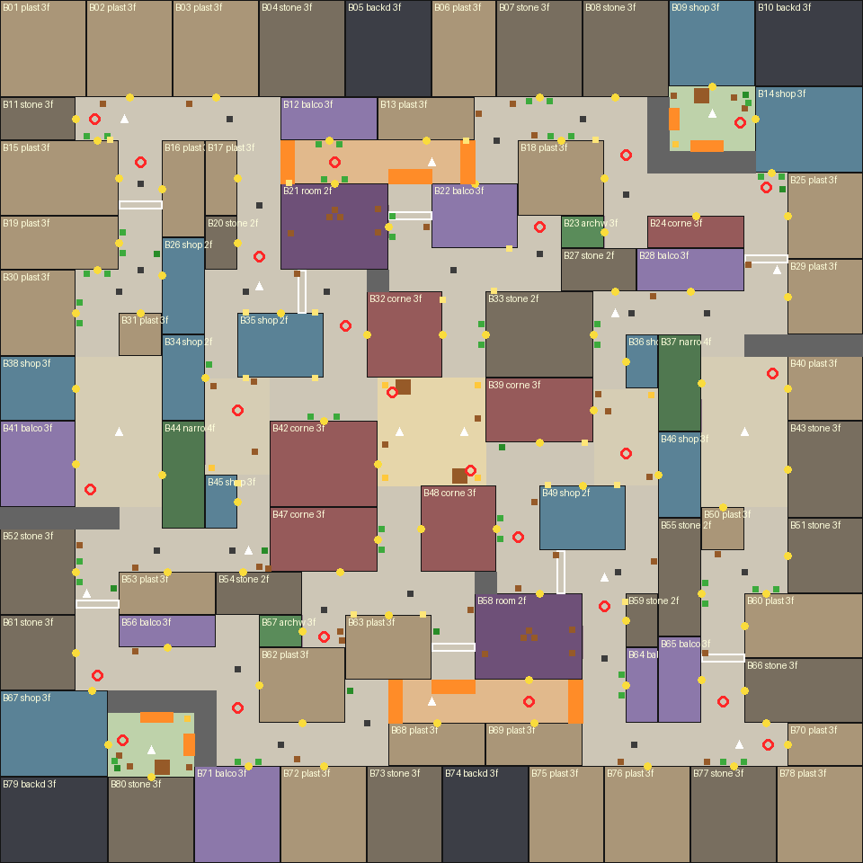
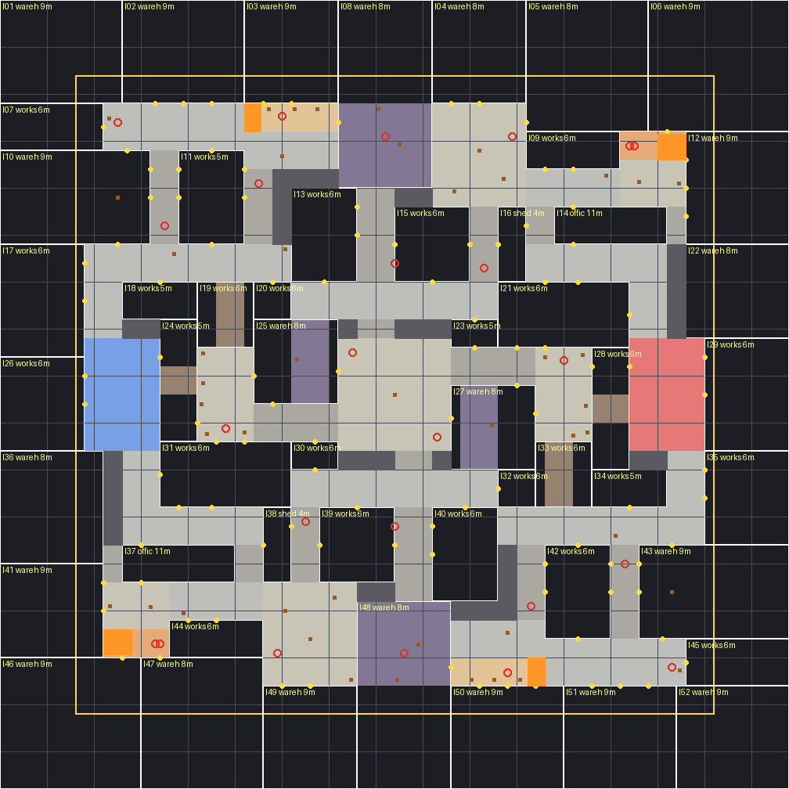
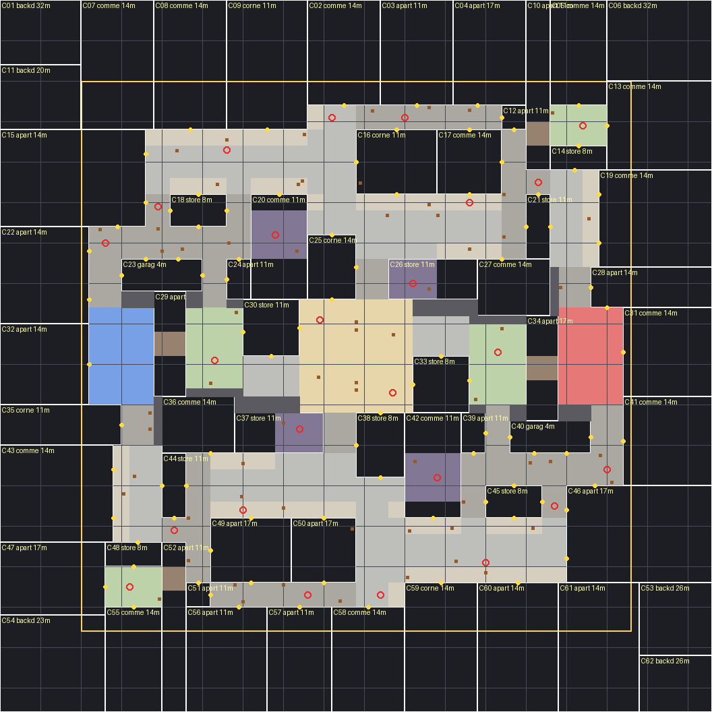

# Level design

Three maps share one schema (`src/maps/<id>/layout.json`), one set of rules (free-for-all: no safe zones or teams,
16 spawn points spread over the map, 24 practice targets, 180° rotational symmetry so every part of the map has an
equivalent counterpart) and one pipeline: a layout tool writes the layout, the Blender stage builds geometry and
collision from it, and the game derives the Tab map from it.

| | European Town | Industrial Complex | Modern City |
|---|---|---|---|
| Layout tool | `tools/layout_design.py` | `tools/layout_industrial.py` | `tools/layout_city.py` |
| Playable area | 66 × 66 m | 68 × 68 m | 68 × 68 m |
| Walkable area | ≈ 2,390 m² | ≈ 2,156 m² | ≈ 2,248 m² |
| Longest straight clear run | 26 m | 28 m | 29 m |
| Median / 90th pct. of a point's longest sightline | 19 m / 27 m | 19.8 m / 27.8 m | 24.5 m / 35.5 m |
| Corner vertices of the walkable outline | 160 | 124 | 120 |
| Buildings (blocks) | 80 (16) | 52 (14) | 62 (13) |
| Covered routes | 6 passages | 4 interiors, 4 passages, 4 canopies, 4 pipe bridges | 4 interiors, 4 passages, 4 canopies |
| Elevation | terraces 0.72 m, courts 0.54 m | docks 1.1 m, gantries 1.8 m | sidewalks 0.15 m |
| Props / targets / spawns | 161 / 24 / 16 | 45 / 24 / 16 | 64 / 24 / 16 |

Metrics come from the layout tools (`python -I tools/<tool>.py` prints them). `tests/map.test.ts` verifies for every
map, against its real `collision.json`, that every spawn is on clear ground and reachable, the spawns are spread over
all four quadrants (≥ 4 m apart, clear of props and targets), there are no safe zones or team data left, every passage
is open, and ≥ 98% of the walkable area is reachable by a player-sized body using the controller's step height.

**Spawns** (`blender/scripts/lib/spawn_points.py`): candidates on a 0.5 m grid of open, flat ground with 1 m clearance,
0.8 m from prop footprints, 2.5 m from targets, 1.4 m from doors and off stairs; farthest-point sampling picks them in
rotated pairs (both points of a pair must be valid, since a few props are not symmetric), starting by the west edge;
each faces the longest clear line from its spot.

## European Town



*Generated by `tools/plan_overlay.py`: buildings by type (labels show id, type, floors), yellow dots = doors,
orange = stairs, white outlines = flying arches, red rings = practice targets, triangles = spawns.*

### Reference and intent

The primary reference (`references/map-layout/maze-layout-overhead.jpg`) is a maze-like blockout with an irregular
outer wall, narrow winding corridors, a central loop and a few small rooms. European Town keeps that density of
corners and connections but simplifies it into readable streets, and dresses it like the style references
(stone and stucco houses, terracotta roofs, shutters, arches across alleys, stone steps).

### Structure

- Playable area 66 × 66 m inside a ring of backdrop houses (the map extends to ±40 m visually).
- **Rotational symmetry** (180° about the centre): every route has an equivalent counterpart, but the buildings on
  each half differ in style.
- The west and east yards (the old team spawn yards, 8 × 14 m) have three exits each (north, south and a gatehouse
  passage toward a gate yard); they are ordinary paved yards now.
- Three lanes between the west and east yards (north, middle, south), cross-linked by alleys, so there are no dead ends.
- A modest central plaza (10 × 10 m) with a well that blocks the straight line through it.
- Two raised terraces (0.72 m, four 0.18 m steps) and two raised courtyards (0.54 m) give elevation changes.
- Six covered passages: two arched bridge buildings, two gatehouses, two walk-through halls (furnished).
- Eight plastered flying arches span lanes between houses.

## Industrial Complex



*`python -I tools/layout_industrial.py`: building lots with id, type and height; ground by kind (spawn yards blue
and red, docks and gantries light orange, stairs orange, passages brown, interiors purple), walls and fences grey,
doors yellow, props brown squares, targets red rings. The Tab map as the game draws it:
[`tactical/industrial-complex.svg`](tactical/industrial-complex.svg).*

- Dense, close-quarters works site: 22 warehouses (8–9 m), 26 workshops (5–6 m), 2 offices (11 m) and 2 sheds (4 m).
  Walls are corrugated cladding, brick or concrete; roller doors, personnel doors, factory and strip windows,
  company signs, floodlights, downpipes, wall boxes, roof ladders and roof plant.
- West and east yards (8 × 12 m, the old team yards), each with three exits: north, south and a gate passage into a
  works yard.
- Streets 4–5 m, alleys 2–4 m, yards 5–12 m (the largest is the central Loading Square, 12 × 12 m). Outer service
  lanes, cross lanes through the middle and short links between yards form loops; there are no dead ends.
- Accessible interiors: a walk-through hall at the north edge and its mirror at the south (three doors each,
  shelving and pallets inside) and two workshops beside the centre (doors north and south). Doors are real gaps
  in the collision.
- Elevation: two loading docks (1.1 m, with dock faces, bumpers and concrete stairs) and two gantry platforms (1.8 m,
  with stairs and railings) overlook the lanes.
- Four canopies and four pipe bridges span the lanes; fences with gates and concrete walls close the yards. Ground:
  asphalt and concrete with yellow lane paint, hazard strips, manholes, patches and oil stains.
- Props break up the open spaces: containers and container stacks, pallets, drums, gas cages, cable reels, tyres,
  jersey barriers, forklifts, transformers, electrical cabinets, skips and shelving.

## Modern City



*`python -I tools/layout_city.py`: same legend; the light strips along the streets are the raised sidewalks. The Tab
map as the game draws it: [`tactical/modern-city.svg`](tactical/modern-city.svg).*

- A tight downtown block: 22 apartment buildings, 16 commercial blocks, 11 storefront buildings, 5 chamfered corner
  buildings, 2 garages (plus 6 backdrop buildings), 1–5 storeys (3.6 m shop floor, 3.1 m upper floors). Brick,
  stucco, concrete and cladding facades with shop floors, fascia and blade signs, awnings, roll-down shutters, fire
  escapes, window AC units, posters, meters, rooftop water tanks, stair huts and AC plant.
- West and east yards (8 × 12 m, the old team yards), three exits each.
- Streets 5–8 m including 1.6 m raised sidewalks (0.15 m curbs), which are generated along every road edge that faces
  a building; crossings, stop lines and double yellow lines. Back alleys 3–4 m with dumpsters, trash bags, utility
  poles and overhead wires. A central plaza (14 × 14 m) with long planters, benches and café tables; two courts per
  half (5–7 m).
- Walk-through interiors: two diners (doors east and west) and two markets (three doors each) with café tables. Their
  doors are real openings, so they work as short cuts between streets.
- Parked cars and a van along the curbs, streetlights, traffic lights and street signs break up the street views.

Its sightlines are longer than the other maps' (median 24.5 m, 90th percentile 35.5 m): city streets are straighter
and wider than town lanes. They are still broken every 10–20 m by jogs, parked cars and street furniture.

## Reference layouts for the new maps

The brief's reference sheet (`references/map-layout/industrial-city-reference-sheet.png`, crops in
`references/industrial-complex/layout.png` and `references/modern-city/layout.png`) shows:

- **Industrial Complex**: a square grid of service roads inside an outer ring road, with the north-east and
  south-east corners cut diagonally, a container yard in the south-west and (team) safe zones mid-west and mid-east.
- **Modern City**: a roughly octagonal block with a ring road, a central building with a round feature, a plaza
  south of it and the zones mid-west and mid-east.

The current layouts were **designed from the written brief**, not traced from these plans: the sheet was saved in
`references_images/` instead of the paths the brief named and was only found after the maps were built. They share
the concept (tight lane grid, zones mid-west/mid-east, a central square or plaza, loops instead of dead ends) but are
square and 180°-symmetric. Matching the plans more closely means re-authoring the `AREAS` lists in the two layout
tools; everything downstream (buildings, collision, Tab map, tests) regenerates from them.

## Editing a layout

The layout is authored as **walkable rectangles** (`AREAS`): streets, yards, courts, plaza, spawn, passages (covered,
inside a building), rooms and interiors (walk-through, with explicit doors). Everything else becomes building mass,
which is decomposed into blocks and split into lots. Areas are written for one half and rotated automatically.
The new maps share `tools/layoutkit.py` (classification, mass decomposition, lot splitting, terraces and stairs,
metrics, plan rendering); `layout_design.py` predates it and keeps its own copy. Both use `spawn_points.py`.

```bash
python -I tools/layout_design.py           # print metrics + render docs/european-town-plan.png
python -I tools/layout_design.py --write   # also write src/maps/european-town/layout.json
python -I tools/plan_overlay.py            # dressed plan with props/targets/doors
python -I tools/layout_industrial.py --write   # Industrial Complex (docs/industrial-complex-plan.png)
python -I tools/layout_city.py --write     # Modern City (docs/modern-city-plan.png)
npm run assets -- --only town              # rebuild buildings, terrain and collision in Blender (or industrial, city)
node tools/export-tactical.mjs             # refresh docs/tactical/*.svg
npm test                                   # reachability, spawn, tactical and z-fighting checks
```

Hand tuning after generation: `layout.json` is the canonical data and can be edited directly (building type,
floors, palette, doors, roof ridge, props, targets, spawns). Re-running the generator overwrites
those edits, so either edit the generator's rules (`choose_type`, `MANUAL_PROPS`, `TARGETS`, `ARCHES`, ...) or
stop regenerating once you start hand-editing.

Rules worth knowing:

- Keep streets on whole metres and aligned with neighbours; 1 m offsets create sliver buildings.
- A passage must lie entirely inside one building lot; the generator reports `LAYOUT PROBLEMS` otherwise.
- Building lots ≤ 2 m thick become walls (gates inside them become gateways); 2 × 2 m lots become pillars.
- Terrace stairs are added automatically wherever a raised area meets lower walkable ground.
- New maps: zones must tile all walkable ground. Unassigned play-area ground counts as building mass for the facade
  generator, so a gap in the zones leaves a blank wall.
- A building next to a fence, railing or pillar lot (`layout_util.OPEN_WALLS`), or at the mouth of another building's
  passage, builds its own plain wall there: those neighbours do not fill their lot, and skipping the wall left
  see-through holes. `node tools/dev-wallgaps.mjs --map <id>` checks a map for holes (European Town: only a 10 cm
  collision margin around two pillars; Industrial Complex: none; Modern City: one two-ray sliver).
- Hand-placed props must stay off stairs and out of doorways: a bench straddled the court stairs in European Town and
  two benches stood in shop entrances in Modern City (moved in `MANUAL_PROPS`).
- Generator variation uses a stable FNV hash of ids, never Python's `hash()` (randomised per process).
