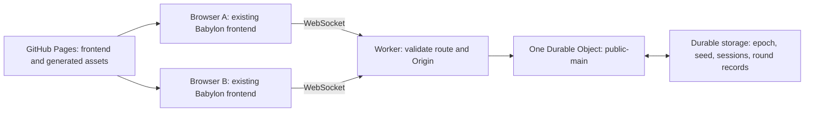

# Multiplayer architecture and migration plan

Stage 1 design, 2026-10-25. **Stage 2 is implemented and tested locally; later stages remain a plan.** Stage numbers follow Part 15 of the user's full Crossfire brief. The current implementation/runbook is in [server/README.md](../server/README.md); verified status is in [PROGRESS.md](../PROGRESS.md). The original audit and future-stage design below remain useful migration context; they are not all current implementation claims.

The latest separate Gameplay/UI brief authorizes its own Stage 1 ahead of this historical order: normal Play now uses real pre-spawn networking, HTTP presence, approved loadouts and a Tab leaderboard. `?practice` retains the local development path. Protocol v2 adds life/weapon/score fields; connected menu clients count online but have no live avatar. The original round/combat stages below remain unimplemented, and runtime match mode/deadline are explicitly null. The SMG belongs to the new brief's Stage 2. Current details are in PROGRESS.md and server/README.md; the rest of this document is the original migration plan.

## What exists and what can be reused

| Area | Inspected evidence | Migration decision |
| --- | --- | --- |
| Frontend hosting | `.github/workflows/deploy.yml` builds `dist/` and publishes it to GitHub Pages; Vite uses relative asset URLs | Keep this hosting and asset-path behavior. A Git remote is configured, but live deployment/account status was not queried. |
| Backend | Cloudflare development tools are installed, but no server entry point, Worker/Wrangler configuration, server scripts, environment template or game network transport exists | Add a separate TypeScript Worker project; there is no working server to replace. No backend endpoint or credentials have been established. |
| Movement | `src/player/PlayerController.ts`, `src/physics/CollisionWorld.ts`, `src/config/constants.ts` are independent of Babylon; current simulation is 120 Hz | Reuse these modules for server simulation and local prediction. Add reconciliation around them rather than rewriting movement. |
| Map collision | `MapManager.ts` loads generated boxes, then adds oriented prop colliders from layout placements and `props.json` | Extract the small pure collision-construction step for both runtimes. Loading only `collision.json` would omit prop collisions. Keep Blender as the geometry/collision source. |
| Weapons and damage | `Weapon.ts`/`Loadout` are pure state machines; `Damage.ts` centralizes headshot damage; `Game.fireShot` currently applies practice-target damage locally | Run weapon legality and player damage on the server. Keep local audiovisual prediction and the current explicit practice path. `DamageSystem` alone does not validate hits or enforce team rules. |
| Targets and health | Targets fall and reset after three seconds; player health is a local field with no incoming player damage/elimination system | Do not mistake target reset for player respawn. Introduce authoritative player health, elimination and respawn in Stage 4. Disable practice targets in public matches on both client and server. |
| Remote players | `TeammateRegistry` stores optional tactical-map data and has no network source | It is not a networking system or player renderer. Add one remote-player registry and renderer fed only by server snapshots. |
| Menu and settings | Minimal home, working practice play/settings, no map chooser; Apply/Back semantics tested | Preserve the latest minimal layout. Public Play, real connection errors and results are unfinished; do not restore username/loadout panels from the superseded brief automatically. |
| Tab | `Input` maps Tab to `map`; `Game.updateTacticalMap` draws the overlay | Stage 5 replaces the binding and visible overlay entirely with the scoreboard. Keep pure map derivation/export utilities if still useful; do not leave two competing Tab handlers. |
| Maps | Town is 66 x 66 m, Industrial/City 68 x 68 m, with existing plazas, stairs and some ground-floor interiors | Preserve generators/assets. Stage 6 adds moderate expansion, route variety and actual upper-floor access. Town currently has a well, not a fountain. Existing rotated symmetry also needs deliberate variation. |

## Runtime boundary and canonical room



The Worker exposes a health route and one public WebSocket route. Every normal join resolves the Durable Object namespace using the same name, `public-main`; client input cannot select or create arbitrary rooms. No lobby or minimum-player queue. Future rooms can reuse the class without being exposed now. Capacity limits must produce a clear error rather than silently creating another room.

Use `DurableObject` from `cloudflare:workers`, `WebSocketPair`, `ctx.acceptWebSocket` and the hibernatable message/close/error handlers. Keep the server import graph free of Babylon, browser globals, Node HTTP servers and filesystem reads. Bundle validated layout/collision/catalog JSON at build time. Node tooling may prepare those files, but it must not become a runtime dependency. Maintain a separate server TypeScript configuration with Worker types.

Cloudflare documents this WebSocket/hibernation pattern, reconstruction after sleep, and connection attachments. Store only compact connection identity in attachments, with durable records for state that must survive closed sockets. Stop simulation timers when the room empties. [Cloudflare WebSocket guidance](https://developers.cloudflare.com/durable-objects/best-practices/websockets/)

Suggested additions, all currently absent:

| Location | Responsibility |
| --- | --- |
| `shared/protocol.ts` | Versioned message types, map/mode IDs, runtime validation and limits; no rendering imports |
| `server/` | Worker router, public room, sessions, pure simulation adapters, runtime tests, its own package/configuration |
| `src/network/` | WebSocket lifecycle, bounded reconnect, clock offset, snapshots, prediction acknowledgments |
| `src/game/RemotePlayers.ts` | One registry, interpolated characters, name tags and occlusion |
| `src/ui/Scoreboard.ts` | Read-only view of real match state, held-Tab visibility |

These paths are a plan, not evidence of implemented components. Prefer small extractions from current code, without moving the rendering or asset pipeline wholesale.

## Shared clock and round lifecycle (Stage 3)

Persist an immutable room epoch, random seed and schedule version once on room initialization, independently of individual joins. Reopening a connection or reconstructing the Durable Object must never reset them. New and returning clients receive the same server-derived state.

Define **600 seconds of active play followed by 5 seconds of transition**, for a 605-second period. This preserves exactly ten minutes of scoring and makes transition duration explicit. For server time `now` in milliseconds:

```text
period = 605000
index = floor((now - epoch) / period)
start = epoch + index * period
end = start + 600000
nextStart = start + period
phase = active if now < end, otherwise transition
remainingActive = max(0, end - now)
```

Derive map and FFA/Teams selection deterministically from the persisted random seed, schedule version and index, with separate map/mode draws. This is server-side randomness reproducible after sleep, not independent client selection. Empty rooms can skip thousands of periods arithmetically without simulating or persisting each one.

Every request/action first reconciles server time with the schedule. Reject scoring at or after the active deadline, and reject messages from another round. Freeze completed results once, reveal the next map/mode, and preload it during transition. At `nextStart`, reset round stats, assign balanced teams and valid spawns. A slow client's loading screen never pauses the room clock; it remains nonparticipating until ready for the matching round and map revision. Joining during transition gets frozen results, next-round metadata and the correct deadline.

Use a deadline wakeup when connected clients need a broadcast, not a tick-counting clock. All callbacks are idempotent and recompute state from time, including callbacks arriving late or more than once. Durable Object alarms have at-least-once execution, so they cannot be treated as exactly-once transitions. No repeating clock alarm is needed with zero clients. [Cloudflare alarm semantics](https://developers.cloudflare.com/durable-objects/api/alarms/)

Use transactional durable state for epoch/seed initialization and result finalization. SQLite-backed Durable Objects are the planned storage backend. [Cloudflare storage guidance](https://developers.cloudflare.com/durable-objects/api/sqlite-storage-api/)

## Protocol, sessions and validation (Stages 2-4)

Client messages carry a protocol version, sequence and current round/map revision. Validate runtime values and message size/rate before simulation; TypeScript types are not a security boundary. Reject nonfinite coordinates/angles, invalid enum values, replayed sequences, unknown actions and oversized payloads. Coalesce redundant movement updates; never grow an unbounded input or send queue.

| Client sends | Server owns and returns |
| --- | --- |
| Join: sanitized requested name, chosen legal weapon, optional resume credential | Random player/session ID, accepted name, session generation, canonical room, complete authoritative snapshot |
| Input: bounded movement intent, look orientation, jump/fire/reload/weapon edges, sequence | Validated position/velocity/orientation, weapon state, last acknowledged input and server timestamp |
| Ready: loaded round ID and map revision | Spawn eligibility and server-assigned spawn |
| Ping/leave | Clock sample, liveness, disconnect/removal |

Snapshots include round ID/phase/deadlines, map/mode, server time, players, teams, positions, health/alive status, weapon, kills/deaths, team totals and frozen results when applicable. Stage 2 introduces only the foundation subset; later stages add authoritative fields rather than accepting placeholder scores or fake opponents.

Create high-entropy server-issued resume credentials; keep them out of URLs and logs. Resume requires proof, not a supplied player ID. Replace an old socket with a new connection generation so its delayed close cannot delete the resumed player. Hide disconnected characters promptly; retain a bounded session record for a short reconnect grace window, then delete it. Reconnect must not reset health, grant free ammunition or reset a round. Rejoining after grace gets a new identity. Usernames are display text, not authentication or HTML.

Use application heartbeats with bounded deadlines because browser JavaScript cannot originate protocol ping control frames. Remove timed-out players, broadcast leave once, and stop room simulation when no active sockets remain. A client also hides stale remote state after a bounded timeout. Restore server-owned session state across object reconstruction; never accept client restoration of health, team or score.

Retain 120 Hz movement substeps initially. Batch input and authoritative snapshots around 20 Hz, independent of rendering FPS; start remote interpolation around 100 ms behind server time. These are proposed tuning values, not measured performance claims. Predict the local player, reconcile to acknowledged server state, and replay pending inputs. Bound catch-up by elapsed server time; client packet volume or claimed duration must not create extra movement. Measure CPU/bandwidth before deciding public capacity.

Rebuild server collision from the same boxes and rotated prop placements as the browser, with a shared map revision/hash checked on join. Public matches omit practice-target visuals and colliders consistently. A pure loader avoids fetching GLBs or creating a Babylon scene on the Worker.

Stage 4 uses server weapon state for cadence, switching, ammunition, reload/cycle timing, spread and range. Validate shots from the server-owned player eye position and legal aim, raycast world obstacles and real player hit volumes, then use `DamageSystem` for accepted damage. Clients never submit damage, kills or a trusted target/hit zone. Friendly fire is denied by the actual team relationship. Begin with authoritative current-state hitscan; any later lag compensation must bound server-recorded history and client timing. Cosmetic prediction does not award score.

FFA gives everyone `team = null`. Teams assigns new arrivals to the smaller active team, preserves existing assignments during a round, and balances again between rounds. Tags use blue for any local teammate and red for opponents, regardless of absolute team color. Skip the local first-person tag and occlude remote tags against world geometry. Spawns use the existing neutral candidates, validated against solid geometry and active player volumes, preferring separation; never add safe zones. If all candidates are occupied, defer and retry rather than overlap bodies. Elimination and delayed respawn are new server behaviors, separate from target reset.

## Incremental client integration and deployment

Stage 2 adds a real development/test entry path and two-client verification without presenting an unfinished public match as operational. Stage 5 changes the normal Play callback from local `play(selectedMap)` to connect/join/snapshot/load/ready/spawn. Use `Game.requestMap` and current disposal behavior for round changes; never reload the page. Connection failure gets Retry and Back. Keep explicit practice available for development; never silently fall back when public Play fails.

Stage 5 adds persisted username/loadout preferences with server validation, removes manual public-map selection, replaces Tab's tactical overlay with a live scoreboard, and drives timer/health/scores/results from server snapshots. Local practice target statistics cannot become public kills. Preserve pause/settings Apply/Back, graphics/audio, weapons, animations and input. In multiplayer, opening settings releases the mouse but cannot pause the shared round or provide invulnerability.

Use a public build-time `VITE_MULTIPLAYER_URL` for the WebSocket endpoint; it is configuration, never a secret. Allow `ws://` only for explicit local development; public Pages uses `wss://`. Server `ALLOWED_ORIGINS` is an exact origin allowlist, including explicit development origins separately. Origins have no repository path. Validate WebSocket Origin and upgrade/route/method directly; HTTP CORS headers alone do not protect a WebSocket handshake. Origin validation does not replace session validation, abuse limits or TLS.

Stage 2 supplies an environment example, local Worker configuration, a health endpoint, typecheck, dry-run bundle and local tests. Review the installed Wrangler version's supported SQLite class configuration and pin its compatibility date. Stage 7 supplies the tested independent deployment commands. Wrangler's local development runs independently of deploying to an account. [Cloudflare local development instructions](https://developers.cloudflare.com/durable-objects/get-started/)

No account login, cloud resources, paid services, remote migrations or deployments are needed for Stage 1. Before an actual backend deployment, the owner provides an account/endpoint and approves the concrete deployment. Frontend CI later receives only the public URL; backend deployment credentials stay outside frontend files and artifacts. Preserve the existing Pages workflow and do not trigger it in this stage.

## Stage gates and validation

| Stage | Completion evidence |
| --- | --- |
| 1. Inspection | This code/hosting audit, migration plan, current feature inventory and baseline checks recorded in PROGRESS.md. No claim of a backend build or multi-client run. |
| 2. Multiplayer foundation | Worker typecheck and dry-run bundle; real local Worker-runtime tests; two independent browser sessions see each other's validated movement; leave, timeout, reconnect and object reconstruction pass; unauthorized origins, malformed messages, replays and movement cheats are rejected. Normal Play remains accurately labeled until Stage 5. |
| 3. Public match | Injected-clock tests for 600-second active/5-second transition boundaries, late joins, empty-room catch-up, restart and late/duplicate wakeups. Two browsers agree on room/round/map/mode/deadlines and transition without page reload. |
| 4. FFA/Teams | Actual two-client combat, authoritative cadence/ammo/hits/occlusion, friendly-fire denial, relative tag colors for both team identities, kill/death/team-score consistency, separation-aware spawns and respawn. One-player rooms contain one player. |
| 5. Menu/leaderboard | Username and loadout work; public Play and unavailable-server Retry/Back work; held Tab shows only the real server scoreboard and prevents focus movement; release/blur/pause close it; FFA sorting/local highlight and team grouping pass; HUD/results update correctly. Existing settings regressions pass. |
| 6. Maps | Each map's expanded area, open landmark and elevated routes are traversed in a real browser; neutral spawns/reachability, visual/collision parity, assets, wall gaps and z-fighting checks pass. Regenerate from source, not hand-patched GLBs. |
| 7. Validation | Full client and Worker builds/tests, multi-browser and load/bandwidth evidence, Pages-subpath production checks, exact independent server deployment/runbook and honest remaining limitations. Deployment still requires permission. |

Keep the existing Node Vitest suite. For Worker-specific tests, use the supported runtime integration with versions checked against the existing Vitest 5 dependency; do not assume an older adapter is compatible or downgrade the frontend suite without evidence. Cloudflare currently documents `@cloudflare/vitest-plugin` for local tests in its runtime. [Cloudflare testing integration](https://developers.cloudflare.com/workers/testing/vitest-integration/)

At each stage, update PROGRESS.md with observed results, outstanding issues and the next stage, then stop under the user's one-stage-at-a-time constraint. Test fixtures and mocked clocks are valid unit-test tools; only real sockets and independent clients can establish multiplayer operation.
