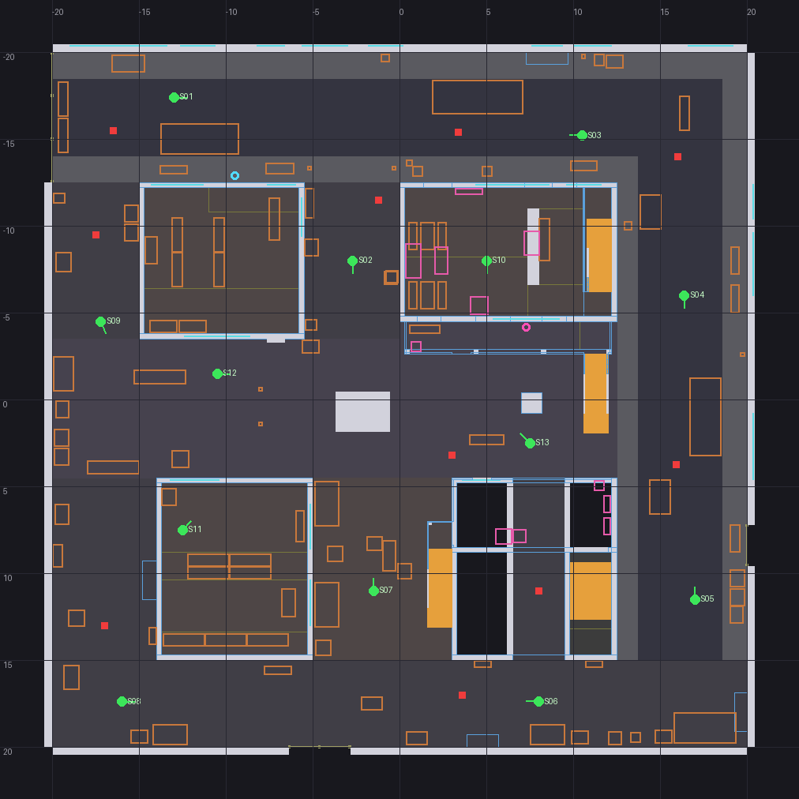

# Neon Backstreets (2026-11-14)

Fifth map, id `neon-backstreets`: a compact, rain-soaked city block at night, built for 1v1 and 2–4 player free-for-all
(small Teams and Zone Control matches work too). It is the smallest map (40 × 40 m play area; Modern City and
Industrial are 54 × 54, Farmstead 74 × 92). All art, signs and textures are original and generated in this repository.



*Plan (`python -B -I tools/layout_neon.py --plan docs/neon-backstreets-plan.png`): white = solids below head height,
blue outlines = upper-level solids, orange = stairs, cyan = glass, green = spawns, red = practice targets.*

## Layout

```
z -20  ===== north facades: Arcade, Hotel Neon, Pharmacy, Corner Bar ======================
       N sidewalk      NEON STREET (one-way road, van and car parked)        fence | vista
z -12.5 ------+---------------+---------+------------------------+--------------------
       WEST   |  24/7 MART    | NOODLE  | RAMEN SHOP (2 floors)  | EAST LANE
       LANE   |  (3 doors)    | ALLEY   | upper lounge, balcony  | (street, two sidewalks,
z -3.5        +---------------+---------+---balcony------stair---+  Karaoke, Bar 88)
       ...... west arm ....  CROSSING (kiosk, ad column) ..... east arm ........
z  4.5        +---------------+ MARKET  +------------------------+
              |  LAUNDROMAT   | COURT   | HOSTEL BLOCK: underpass,|
              |  (2 doors)    | (stalls)| roof terrace, stairwell |
z 15   -------+---------------+--stair--+------------------------+--------------------
       BACK ALLEY (dumpsters, skip, service doors, string lights)
z 20   ===== south back facades (gated gap behind the court) ===============================
```

* **Loops.** The outer ring (Neon Street → West Lane → Back Alley → East Lane) and the inner cross (Noodle Alley →
  Crossing → Market Court / Underpass → Back Alley) give at least two route loops everywhere. The walk-through shops add
  short-cuts: the Mart (street, Noodle Alley and West Lane doors), the Ramen shop (street and crossing doors plus a kitchen
  back door), the Laundromat (crossing and West Lane), and the hostel underpass. There are no dead ends: the
  integrity audit's dead-end check is clean, and every spawn reaches every other spawn.
* **Ranges.** Shops and alleys (3–8 m) suit shotguns and SMGs. The crossing and the side lanes (10–20 m) suit rifles.
  Neon Street, the lanes and the back alley are 26–39 m lanes for snipers and semi-autos. No straight eye-level line
  crosses the whole block (the shared sightline test requires < 40 m).
* **Verticality (small).** Two decks at 3.55 m face each other across the crossing:
  * the **ramen balcony**, reached by the exterior stair in the crossing's east arm or through the upper staff lounge
    (whose interior stair comes up from the kitchen; the lounge's open windows overlook Neon Street);
  * the **hostel roof terrace**, reached by the steel stair in the market court or the stairwell from the underpass.
  Both have a drop-down gap in their railing, so neither is a one-entrance camping spot.
* **Cover.** A kiosk and a lit advertising column in the crossing, a jersey barrier, the balcony stair (a solid concrete
  flight), parked cars, a van, dumpsters, a skip, market stalls, vending machines, store aisles (1.45 m: standing players
  see over them, crouching ones hide), the washer island and the ramen counter (0.95 m, jumpable).
* **Spawns.** 13 spawns, picked with a line-of-sight search: no two see each other within 13 m, and all are 6 m apart, clear
  of the Zone Control squares, in every quadrant, each facing an open line. Two are inside shops (Ramen dining room,
  Laundromat). The shared spawn selector still prefers screened, distant spawns at runtime.
* **Zone Control** squares: A on Neon Street (-6.5, -16.4), B in the crossing (2.6, -0.6), C in the back alley (-10, 17.6).

## How it is built

| Part | Source | Output |
|---|---|---|
| Buildings (walls with openings, slabs, stairs, rails, posts, glass, sidewalks, fences) | `tools/neon_structures.py`, using the Farmstead element helpers | layout `farm.structures`; mesh and collision from `blender/scripts/lib/farmstead.py` (one spec, so the visuals and collision cannot disagree) |
| Zones, props, spawns, targets, lights, validation | `tools/layout_neon.py` | `src/maps/neon-backstreets/layout.json` |
| Neon dressing (signs, blades, tubes, lanterns, cables, graffiti, puddles, bake lights, room fill, rain areas, vistas) | `tools/neon_dressing.py` | layout `neon` |
| Dressing meshes, glow cards, windows, skyline, light bake | `blender/scripts/lib/neon.py` | merged into `terrain.glb` |
| Ground, paint, puddles, drains, assembly | `blender/scripts/lib/terrain_neon.py` (stage `neon` in `generate_all.py`) | `public/assets/models/neon-backstreets/` |
| New props (store shelf, drink fridge, washers, dryers, scooter, bicycle, ramen cart) | `blender/scripts/lib/props_neon.py`, `catalog.py` | `models/shared/props/` |
| Sign/panel/window/graffiti atlases, glow cards, skyline texture, night sky | `tools/make_neon_textures.py` (Pillow), cells in `blender/scripts/lib/neon_art.py` | `textures/neon-backstreets/`, `env/sky_neon_1k.hdr`, `sky_neon_2k.jpg` |
| Rain | `src/rendering/Rain.ts`, created by `MapManager` when the layout has `neon.rain` | runtime only |

Rebuild:

```
python -B -I tools/make_neon_textures.py         # only after changing the art
python -B -I tools/layout_neon.py --write
blender -b --factory-startup --python-expr "import sys; sys.dont_write_bytecode = True" -P blender/scripts/generate_all.py -- --only neon
#   (add materials,props when materials.py, catalog.py or props_neon.py change; then node tools/generate-bullet-surfaces.mjs)
git checkout -- blender/scripts/lib/__pycache__   # if Blender touched tracked bytecode
npm test --prefix server                          # rebuilds the Worker bundle with the new world
```

`farm.structures` is the shared container for element-authored buildings: `collision_gen`, the tactical map and
`movementSafety` already read it. The map has no `farm.perimeter`, so it keeps the four invisible boundary slabs
behind its facades and fences.

## Neon and lighting

Babylon gives each material four real lights, so almost all of the glow is built into the assets:

* **Self-lit (`unlit`) materials:** `neon_tube` (hue in vertex colours, tint 2.6 so tube cores tone-map toward white and
  feed bloom on Medium and up), `neon_signs` / `neon_panels` (sign and ad atlases), `neon_windows` (lit window cells) and
  `neon_skyline` (distant towers).
* **Additive glow cards (`additive`: no depth write, no fog, never occluders):** a halo in front of every sign, a wash
  of coloured light on the wall around it, a pool at its foot and a rippled wet-ground reflection streak (`neon_wet`) on
  the pavement in front; ribbons along every tube; crossed halos on lanterns, bulbs and aviation lights; floor, lower-wall
  and ceiling fill inside each lit room. `MaterialLibrary` supports both flags; `VisibilityWorld` and the map audit ignore
  blended materials.
* **Baked light pools:** `neon.bake()` subdivides lit surfaces near each of 33 sources into about 1 m cells and tints their
  vertex colours (ambient 0.7, contact darkening at wall feet, under ceilings, balconies and the underpass). Room lights
  reach only their own room.
* **Real lights:** the sun is a dim blue moon (0.75), the night HDR fills in colour, and two point lights (crossing pink, Neon
  Street cyan) plus the ramen pendant light the characters. That stays inside Babylon's four-light budget together with
  the sun.
* **Wet streets:** glossy asphalt and concrete (roughness 0.42 and 0.5) pick up the coloured sky domes; dark mirror-like
  puddle decals; neon reflection streaks; light rain.
* **Night sky:** procedural (no sun disc): navy zenith, violet city haze, clouds lit from below, four coloured glow domes, a
  few stars.

## Chromebook mode

Chromebook mode keeps every sign, tube, glow card, baked pool and window, so the map stays recognisably itself without
bloom, reflections or normal maps. `EnvironmentConfig.lowSpecAmbient` (new, optional) replaces the daytime hemisphere
fill with a dim violet night ambient (0.3) for this map, and rain drops to about a quarter of the particles. Geometry,
collision, props and visibility are identical in both modes.

## Performance (dev Intel Iris Xe, 1600 x 900, uncapped, `node tools/neon-perf.mjs`, after the polish pass, one run)

| preset | Neon Backstreets | Modern City |
|---|---|---|
| low | 65.0 fps (136 draws) | 76.9 (113) |
| medium | 57.4 (140) | 64.4 (117) |
| high | 47.7 (145) | 54.1 (122) |
| Chromebook | 200.4 (134) | 163.2 (112) |

Before the polish pass the same tool gave 62.9 / 57.5 / 48.6 / 166 (124 to 133 draws) against 79.8 / 66.3 / 55.7 / 150. The
iGPU heats up between runs (one Chromebook sample read 184 vs 249): only the same-run ratios mean anything. Rain costs
nothing measurable. The remaining gap to Modern City on the standard presets is the additive overdraw (a few dozen large
soft cards) and the two point lights. The terrain GLB is 5.2 MB, the map has 484 collision boxes and 134 props.

## Polish and upgrade pass (2026-11-14)

Reference images added for this pass: `references_images/neon with vending machines.jpg`, `more neon.jpg` and three saved
image-search pages (rainy ramen alleys, vending machine rows, fire escapes over wet streets). The audit against them, and what
changed:

| Weak point found | Change |
|---|---|
| Flat, dim facades: only a handful of signs, few colours, little vertical rhythm | 10 more vertical yokocho-style blades (izakaya, ramen, sake, bar, motel, udon, club, mahjong, cafe, pachinko) in pink / cyan / yellow / green / orange / red / purple, three more boards (izakaya, udon, motel), a big double-sided arch sign "NEON BACKSTREETS / ネオン裏通り" hung over the crossing (the focal point of the long west and east views), 9 more tubes (door outlines, wall strips inside the mart, laundromat and underpass), stronger halos (+30 %) and washes (+25 %) |
| Wet ground read only as dull streaks | every sign pool now has a second, longer reflection streak; puddles carry two glints in the colours of the nearest signs; stronger pools; cracked asphalt cards; short splash sprays where rain lands (55 % of them on puddles) |
| No atmosphere between the viewer and the signs | tinted fog (`fogColor` [0.10, 0.085, 0.20], density 0.0115) that fades alleys into a glowing haze, soft light shafts under every tall blade sign and sodium cones under the two streetlights, steam from seven vents (ramen hatch, manholes, dryer, kitchen exhaust) |
| Few believable lit props | `vend_red/blue/yellow/white` (dense, colourful, self-lit cans on a dim lit panel; each throws a pool and a halo), `phone_booth`, `gacha_bank`, `sandwich_board` (chalk specials), `bamboo_pot`; lit-prop glows derive from the props (`layout_neon.derived_light`), so moving a prop moves its light |
| Plain storefronts and walls | four canvas awnings (solid, 3.05 m up, never over a deck, stair or spawn), red noren curtains with brushed glyphs on the ramen doors (double-sided), four visual-only fire escapes, rain streaks / rust / stickers (alpha-cut decals 12 mm off the wall), more overhead cables, lantern strings inside the ramen shop and over the east lane, rooftop clutter (tanks, vents, AC boxes, antennas with aviation lights) |
| Bland interiors | strip lights along the mart, laundromat and underpass walls, lantern strings in the dining room |
| Gameplay: the east lane was a 35 m run with one parked car; the crossing and the back alley had long open stretches | two dumpsters and a barrier in the east lane, a phone booth and a planter in the crossing, a wrapped pallet load and pallets in the back alley, a vending bank by the west lane. Spawns, zone squares, stair feet and doorways are unchanged (all tests that guard them pass) |

Cost control: the can colours are one `can_lit` material with the hue in vertex colours (6 materials -> 1); steam is three
tint groups (three systems, picking a random vent per puff; Chromebook keeps two at half rate and no splashes); the arch,
beams, awnings and fire escapes are a few dozen quads and tubes. The terrain GLB grew from 4.2 to 5.2 MB; draw calls from 124
to 136 on Low. The sign atlas is now 2048 x 3328 (the new cells sit below the old ones; old cells keep their pixels).

Rules this pass added (the geometry z-fight test enforces them):
* Ground cards use fixed heights above the floor so no two share a plane within 2 mm: oil .002, paint .005, crack .0075, puddle
  .009, puddle glint .0205, reflection streak 2 .0235, spill .026, streak 1 .03, room fill .035/.04, streetlight pool .041, arch pool .045.
* Visual-only fire escapes stand 8 cm off the facade (frames, sills and ACs are proud by up to 7 cm); anything with a back face
  against a wall plane z-fights.
* A single-sided card seen from behind is a `seeThrough` audit error: the noren has a mirrored back quad 1 cm behind the
  front; the phone booth's back panel faces the door; the sandwich board has end caps.
* A prop collider must cover everything visible of it (`walkThrough` audit): the bamboo's collider is the full 2 m column.

## Tests and review tools

* `tests/neonBackstreets.test.ts`: every doorway walked both ways with no gun, a rifle and a sniper; every staircase up and down;
  both deck loops (up one route, down the other); drop-down gaps and railings; glass stops walkers and bullets while the
  ramen hatch stays open; spawn screening; rifle lanes; Practice navigation reaches every spawn and both decks.
* Shared suites run on it as on every map: `map`, `mapOverhaul` (spawn connectivity, sightlines < 40 m), `mapIntegrity`
  (no see-through walls, escapes, floating props or lights), `collisionSafety`, `geometry` (no z-fighting), `assets`,
  `tactical`, `posters`, `stageAProps`, `zoneControl`, `practice` (real armed bots traverse it: decks reached, nobody stuck).
  The street-block-only suites (`compactMaps`, `mapRealism`, `phase2Maps`, `stairSliding`) skip it, as they skip the Farmstead.
* Backend: map rotation over all five maps; authoritative prop bullet surfaces on this map.
* Browser: `node tools/neon-shots.mjs <url> [group] [--chromebook] [--quality=...]` (contact sheets in `test-results/neon*`),
  `node tools/neon-practice-test.mjs <url>` (real UI, 5 bots, 40 s), `node tools/neon-perf.mjs <url> [maps]`,
  `node tools/neon-thumb.mjs <url>` (menu thumbnail). `tools/perf-test.mjs` now knows this map's views, but that tool's
  `?autoplay` path waits for a network join and times out on every map.

## Known limitations

* The first version had no reference images (written brief only); the 2026-11-14 pass used the added references. Nothing is copied from them: all art, signs and textures are original.
* The wet-ground reflections are static streaks, not view-dependent (no planar mirror: it would not fit the budget). The rain ignores
  small overhangs (it is kept out of roofed footprints and lands on decks); splashes are short sprays, not ring ripples.
* The fire escapes, rooftop clutter and the arch sign have no collision: they are out of reach and bullets pass them.
* Standard presets run about 10–20 % below Modern City on the dev iGPU. Physical Chromebook hardware was not measured.
* Two parked props (the car, the van) and the skip can be jumped onto (audit `climb` warnings, as on other maps). The
  market-stall canopies are reachable from the stall counters.
* A matching frontend and Worker release is needed when authorised: `MAP_IDS` gains a fifth id, so the public schedule's
  shuffle bags change and an old client would reject a `neon-backstreets` snapshot. The protocol version is unchanged
  (as when the Farmstead was added). `server-dedicated/dist` is a stale incomplete scaffold and was not rebuilt.
